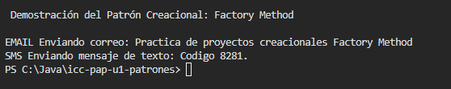

Metodo Factory Method 
Este patron su funcion es no tener la necesidad del new en el codigo para cada objeto, en otras palabras este tipo de metodo es como declarar una orden, en este caso nosotros creamos la orden SMS, con el metodo receptamos las ordenes y ya sabe de que tipo debe ser esa orden, le enviamos lo que queremos en esa orden y asi no tener que crearla con new. 

En la clase principal app creé el metodo runFactory que es el que hace las peticiones para no tener que crearlas manualment, se llama al metodo y le digo que tipo de mensaje quiero, en este ejercicio SMS o EMAIL pasandole el texto del mensaje.

En FactoryMethodDemo.java en este caso seria la que recibe las ordenes, recibe el texto de tipo notificacion y evalua si es SMS o Email, se encarga de instanciar la clase correcta aademas que todas las notificaciones heredan una interfaz Notificacion, esto nos garantiza que no importa el tipo de orden que se le mande ya que todas saben como poner ejecutar correctamente el metodo enviarMensaje. 

Ejemplo de salida 

